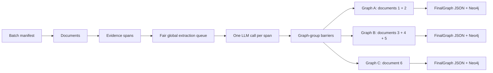

# Grouped multi-document batches

A batch is an orchestration boundary. A document is one input text file. A graph
group is the only entity-resolution, persistence, and Neo4j namespace boundary.
Documents in one group can resolve to shared entities; documents in different
groups are never compared.



Start from [`config/batch.example.yaml`](../config/batch.example.yaml). The
manifest is strict and versioned. Every declared document must exist and belong
to exactly one non-empty graph group. IDs must be unique. Provider and model
identities are explicit, and the output directory must not exist.

Run a batch with:

```powershell
python -m scripts.run_batch --manifest config/batch.yaml
python -m scripts.run_batch --manifest config/batch.yaml --output outputs/example_batch
```

The fair round-robin queue rotates among documents and enforces global,
per-document, and per-graph in-flight limits. Every item is one independent
schema-constrained request for one evidence span; no document or span packing is
performed. Completion order never determines ownership or document-local order.

A group finalizes only after all its spans are structurally accepted. It then
runs one group-scoped embedding/entity-resolution stage, validates authoritative
FinalGraph JSON, and projects that graph into a namespace derived from batch ID,
graph ID, and graph-manifest hash. Matching entity mentions can join evidence-
backed relations within a group, but the pipeline never synthesizes a relation
between documents.

With `continue_other_graphs_on_failure: true`, a failed group writes a terminal
failure report while unaffected groups continue. A failed group does not embed,
persist a FinalGraph, or mutate Neo4j. With `false`, no new work is admitted after
the first failure; already in-flight requests finish and are recorded, and no
partial graph is published.

Artifacts are stored under the batch root as a resolved public manifest,
document source manifests and per-span request/response directories, graph
manifests and authoritative graphs, parity/completion reports, and an aggregate
batch report. Absolute source paths and credentials are excluded.

`deepseek_v4_flash_0731_vllm` is the default profile and requests
`deepseek-ai/DeepSeek-V4-Flash-0731`. The deployment is expected to configure
the DeepSeek V4 tokenizer, tool-call parser, auto-tool choice, and reasoning
parser. Validate the actual endpoint manually with:

```powershell
python -m scripts.probe_model_compatibility --provider-profile deepseek_v4_flash_0731_vllm
```

Kimi remains explicitly available through `kimi_k2_6_vllm_structured`. There is
no automatic model fallback and a batch uses exactly one primary profile. Both
profiles use the unchanged `prompt_kimi_default` prompt and
`fact_extraction_schema` contract in this repository.

The legacy single-document command remains unchanged:

```powershell
python -m scripts.run_production --input examples/sample_input.txt --output outputs/run
```

Run the deterministic scheduler benchmark with
`python -m scripts.benchmark_batch_scheduler`. It performs no network calls.
